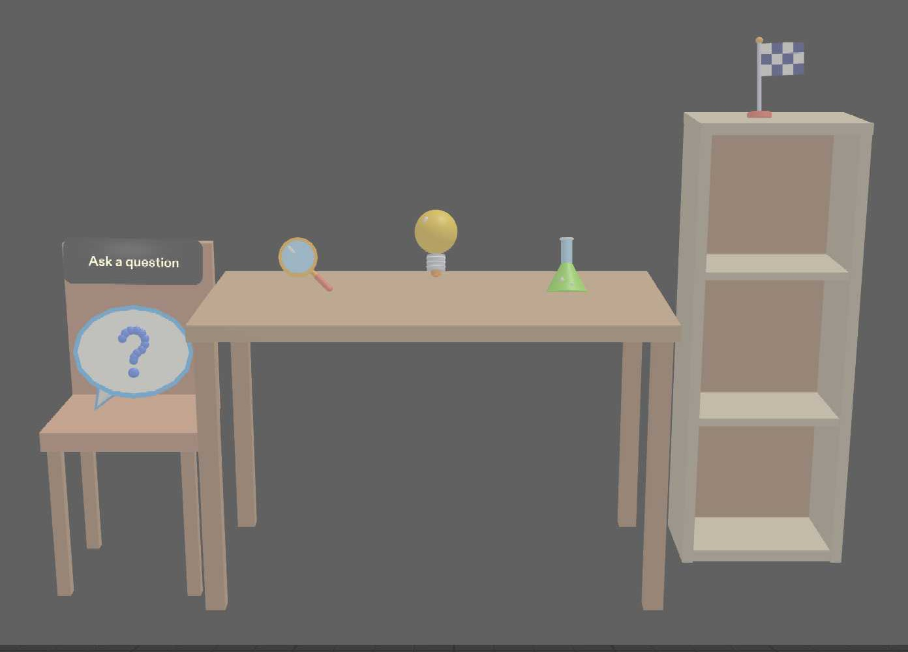
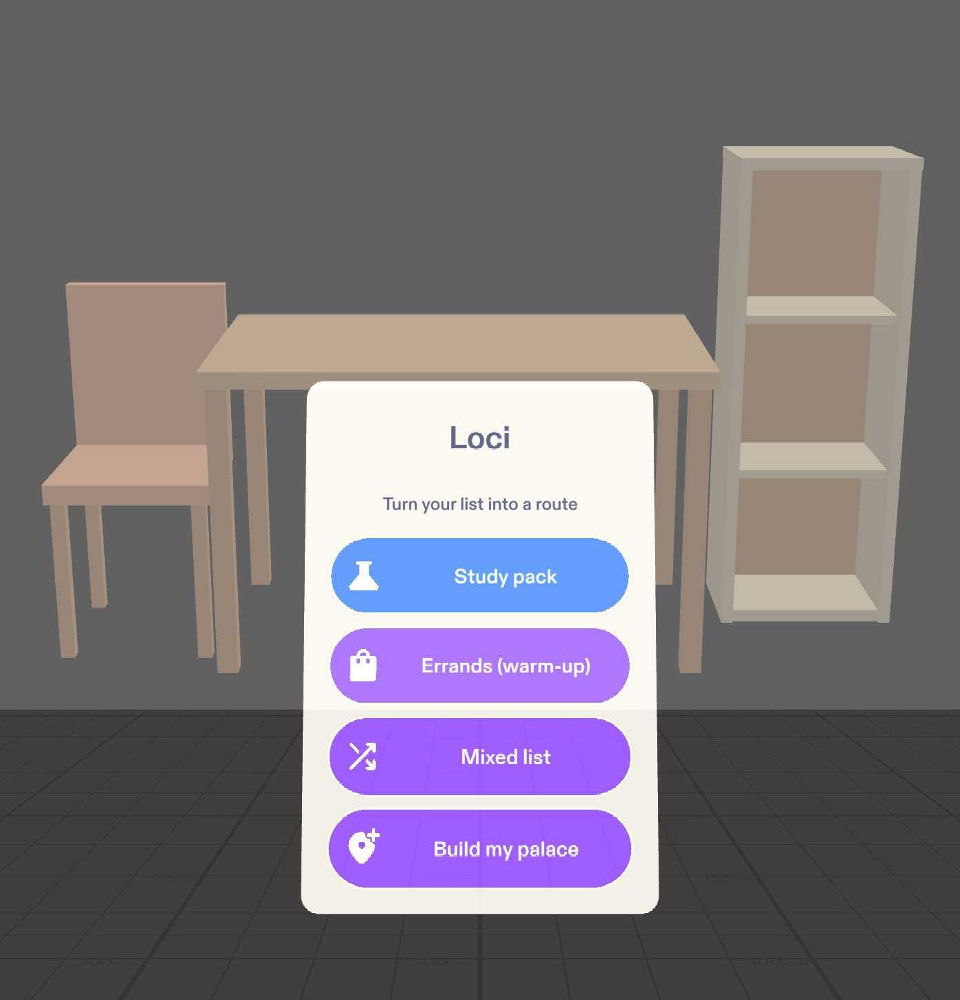
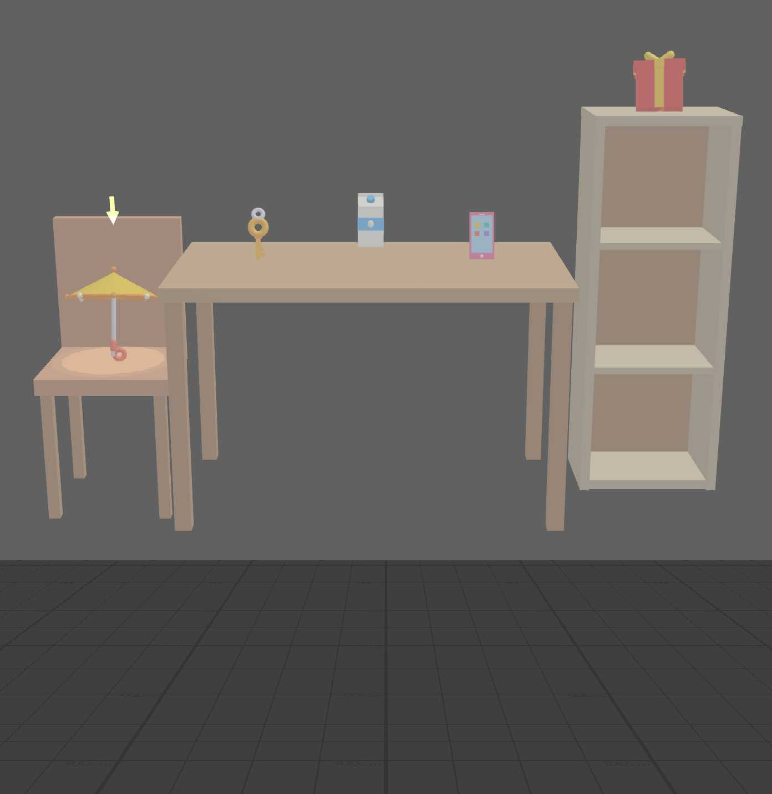
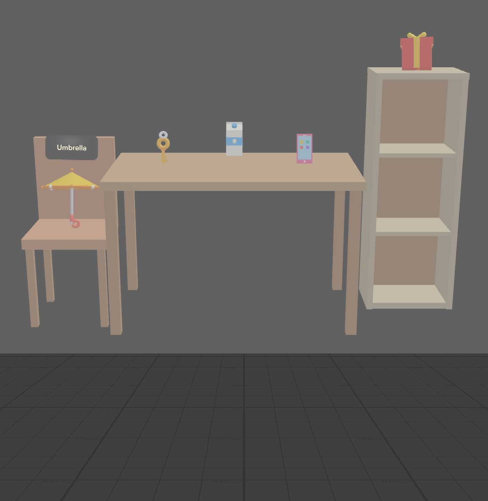
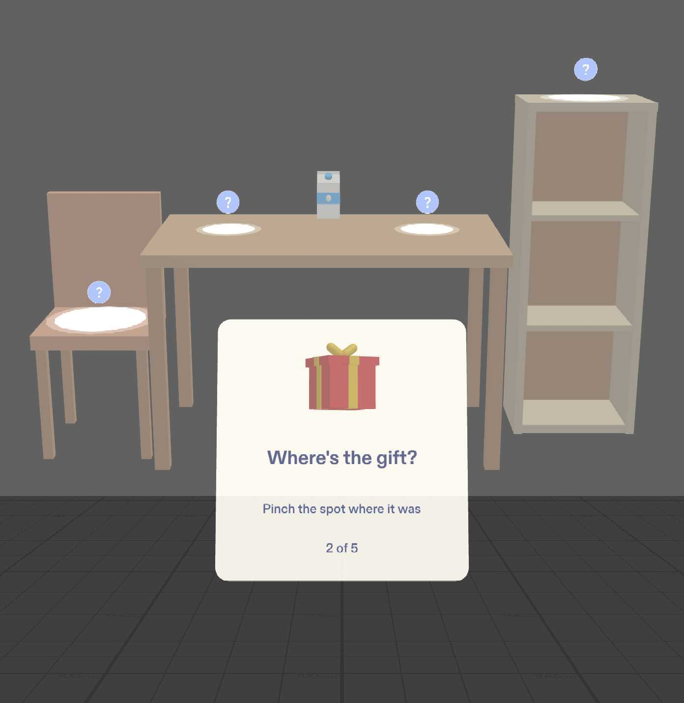
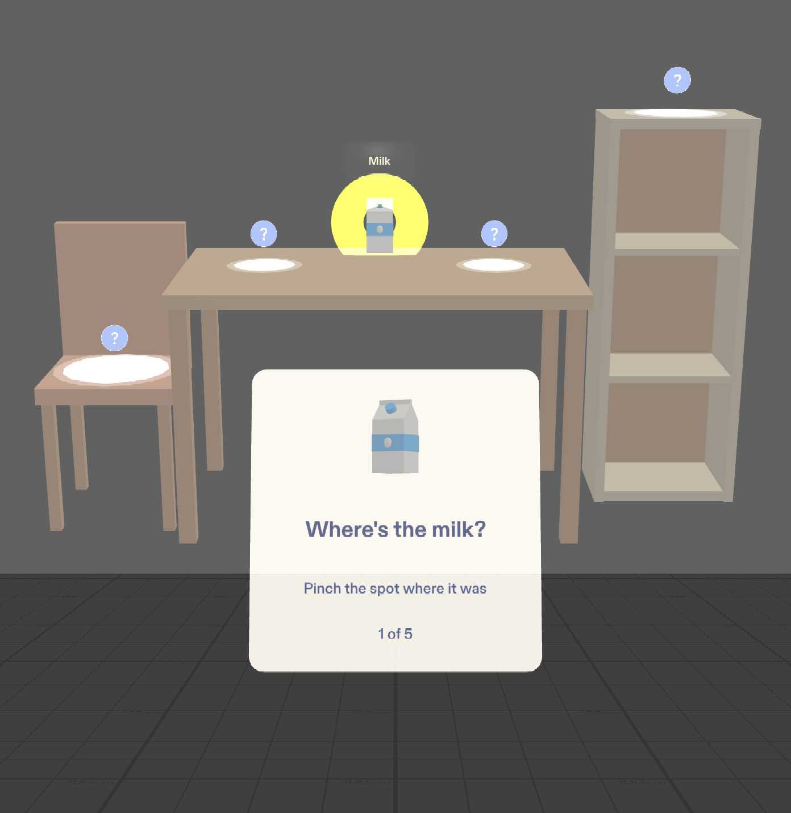
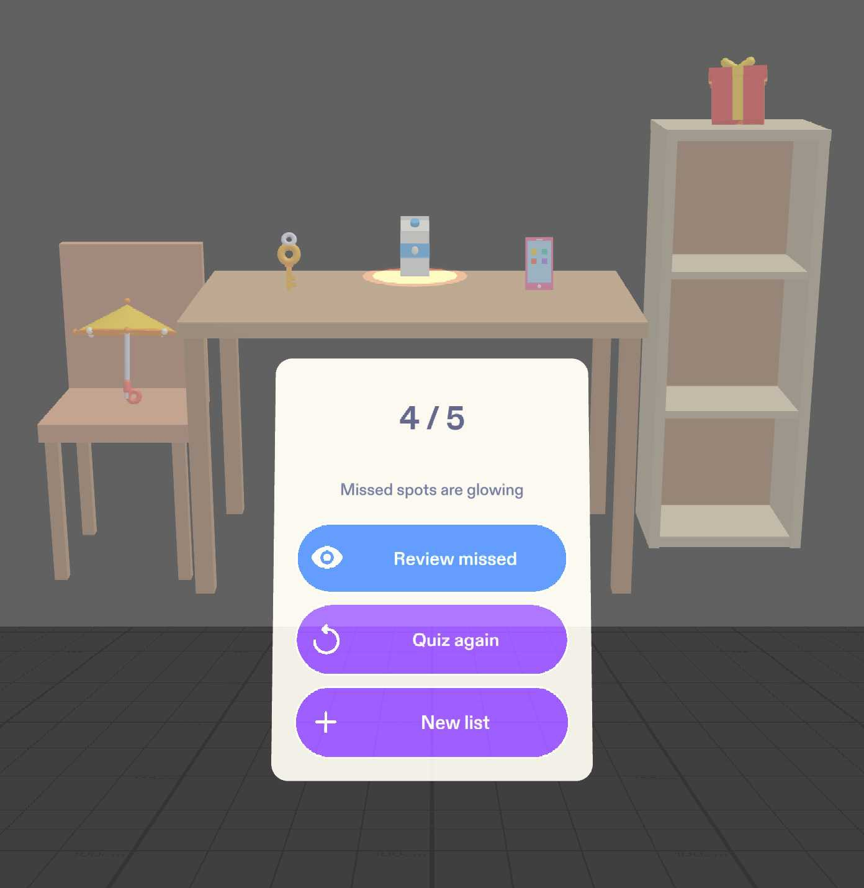

# Loci

**Turn any five-item list into a memory palace on real furniture.** Bright 3D objects drop onto a chair, a table and a shelf in order; you walk the route, then prove you remember by pointing at where each thing was.

▶ **[Watch the demo (2:45)](https://youtu.be/gZ-cKs-1MSA)**

A Lens for Snap Specs, built in Lens Studio 5.23.2 and verified with 13 passing LEAF tests in the preview.

---

## Why glasses

- **The method of loci needs real places.** Memory champions remember lists by placing each item somewhere along a route they know and walking it in their head. On paper or a phone that palace exists only in your imagination. With glasses it is real: the items sit in your room, on a route you actually look across.
- **Objects at real size, on furniture.** A 30 cm umbrella opens on the chair seat and a milk carton hops on the table. Each one stands at its true size and position, so there is a *where* to remember, not just a *what*.
- **Hands free, eyes up.** One pinch per step and no screen to look down at. You keep your eyes on the route, which is the thing you're trying to remember. A phone would pull your attention onto the phone.

## How it works

**1. Pick a pack, or build your own palace.** The start card offers a scientific-method **Study pack**, **Errands (warm-up)**, a **Mixed list** with a made-up word, and **Build my palace**. On Specs there is also **Say my list**.

**2. Watch your list become a route.** Five objects drop one at a time onto the chair, the table (left, centre, right) and the shelf. They read left to right like a sentence, each with a bounce and a chime from its spot.

**3. Walk it.** Only the current spot pulses, with an arrow above it. Pinch the object: it plays a short silly animation (the umbrella spins open, the light bulb lights up) and shows its name. Then the arrow moves on. After spot 5, all five glow together.

**4. Find it.** "Quiz me" hides every object behind an identical "?" marker. A card asks "Where's the milk?" with a small 3D icon of it, in a shuffled order. Pinch the spot where you think it was:
- **Right:** the object pops back with a green ring and a chime.
- **Wrong:** the spot you pinched shakes red, then the right spot briefly shows its object with an orange ring.

 

**5. See what you missed.** Your score counts right first tries ("4 / 5"). The missed spots glow where they are. **Review missed** walks only those spots; **Quiz again** reshuffles; **New list** starts over.

More screenshots, numbered by phase, are in [`devpost/screenshots/`](devpost/screenshots/):
- the "Walk again / Quiz me" card;
- a word totem ("volcano");
- the study pack;
- building a palace;
- the finished palace;
- a LEAF run.

## Judge it in 90 seconds

Every done criterion in the [design brief](devpost/design-brief.md) is a LEAF scenario, and each one pinches through SIK exactly as a user would. **13 of 13 pass** in the Lens Studio preview. Full numbers are in [`devpost/validation/LEAF.md`](devpost/validation/LEAF.md) and [`leaf-results.json`](devpost/validation/leaf-results.json).

| Done criterion | LEAF scenario | What it measured |
|---|---|---|
| 1. A preset list places 5 models one at a time, in route order | `loci-c1-sample-list` | The models landed 0.53–0.57 s apart, chair → shelf, and the count stepped 0→5 one at a time. Study began 3.73 s after the pinch. |
| 2. Pinching the current object moves the pulse and arrow on; one pulse at a time; "Quiz me" after spot 5 | `loci-c2-study-walk` | A pinch on a non-current object was ignored. The pulse advanced 1.99–2.00 s after each pinch, with at most 1 spot pulsing in any frame. The arrow sat within 0.4 cm of each spot. |
| 3. "Quiz me" hides all 5 behind identical markers and asks "Where's the …?" in a seeded order; the right spot brings the object back with a green ring | `loci-c3-quiz-reveal` | 5 neutral markers and no pulse or arrow. "Where's the milk?" with the milk icon, "1 of 5". The right pinch gave a green ring, and the found spot left the targets. |
| 4. Right spot for 4 items, wrong spot for the milk: "4 / 5", only the milk glows, "Review missed" walks only it | `loci-c4-results-review` | "4 / 5", answers [✓,✓,✗,✓,✓], glowing = [milk] only. The review walk visited only the milk's spot. |
| 5. Mixed list: key for "keys", phone for "mobile", a totem reading exactly "volcano" | `loci-c5-mixed-list` | Plural and synonym both matched. Exactly one Text3D "volcano" at table centre, and no near-miss model. |
| Find-it: a wrong pinch reveals the right spot | `loci-c6-wrong-reveals-correct` | The wrong spot shook red. 0.59 s later the right object appeared with an orange ring and its name, then hid again 1.94 s after that. |
| Find-it: each item asked exactly once | `loci-c7-each-item-once` | 5 prompts, no repeats, in the seeded order (not route order). Each had its own question, icon and "n of 5". |
| Find-it: "Quiz again" resets the score | `loci-c8-quiz-again-resets` | Round 1 gave "4 / 5". After "Quiz again" the score was 0 with a new seeded order, and round 2 gave "5 / 5". |
| "New list" clears every spot | `loci-c9-new-list-clears` | Geometry was destroyed at all 5 spots, with no markers, glows, rings or targets left. The route refilled cleanly. |
| Study pack plays and quizzes by step | `loci-c10-study-pack` | 5 study models in order. Each animation's signature move played and the model settled exactly back to rest. The prompt read "Where's the hypothesis?". 18 synonyms matched. |
| Build my palace: 5 pinches make 5 places, in order | `loci-c11-palace-five-spots` | Each place landed 0.00 cm from where its ray hit the surface. The places were numbered 1–5 and joined by 4 lines, and the route spots moved there. |
| Build my palace: a too-close pinch is rejected | `loci-c12-palace-too-close` | A pinch 11.7 cm from a place was rejected: that place shook and the card explained, still "2 of 5". |
| Build my palace: the quiz works on custom spots | `loci-c13-palace-quiz` | Objects and markers sat over the custom places (within 1 cm). Missing the milk gave "4 / 5" with only its place glowing. |

**Fastest check:** open the project, open the LEAF panel, and run `loci-c4-results-review` (about 55 s). It drives the whole flow, from list to results.

## What makes Loci different

- **Objective recall, by pointing.** Loci doesn't ask whether you remembered: it asks *where* the thing was, and you point at the place. The Lens knows the answer, so the score isn't a self-report. Recalling by place is exactly what the method of loci trains, and pointing at a place in your room is something only glasses can ask for.
- **Build your own palace.** Pinch any five surfaces (chair, table, shelf, floor) and they become the route, numbered and joined in the order you chose. A palace you chose yourself is easier to walk in your head. It stays for your next list, because the method is meant to reuse one palace for many lists.
- **Any word works.** Words with a model (and their synonyms and plurals) get bright animated 3D objects. Any other word becomes a **word totem**: the word in bright 3D letters on a base whose shape and colour are unique to its spot. Nothing is ever swapped for a near-miss model.
- **Study packs, not just shopping lists.** The scientific-method pack turns five abstract steps into five vivid objects:
  - a speech bubble for *Ask a question*;
  - a magnifying glass for *Research*;
  - a light bulb for *Hypothesis*;
  - a flask for *Experiment*;
  - a checkered flag for *Conclusion*.

  The quiz then asks for the step itself ("Where's the hypothesis?"). Errands are the warm-up.

## Built with

- **A plan-lens design brief written before any code:** [`devpost/design-brief.md`](devpost/design-brief.md). It covers the one spatial moment, where everything lives (in cm, measured from where the user stands), when things show, and the done criteria. Its "v2 changes" section records the Find-it quiz, the study pack, Build my palace and the framing fix.
- **Claude Code + CLAD + the Lens Studio MCP.**
  - CLAD's Specs builder agent wrote the first build.
  - CLAD's live Lens tester agent set up LEAF and wrote the first tests.
  - CLAD's sound synthesizers made the chimes.
  - Every later change went through the Lens Studio MCP: scene edits, recompiles, preview logs and screenshots, and LEAF runs.
  - The story, including what went wrong, is in [`devpost/BUILD_LOG.md`](devpost/BUILD_LOG.md).
- **LEAF 2.0.2** for live interaction tests in the preview.
- **Lens Studio 5.23.2**, not 5.24, because of a sign-in issue in 5.24.
- **Spectacles Interaction Kit 0.18** (pinch, hover, interactors) and **Spectacles UI Kit** (cards and buttons).

## Real glasses vs. preview

| | On Specs | In the Lens Studio preview |
|---|---|---|
| Build my palace surfaces | World Query surface hit-testing on your real surfaces (the "Build With World Query" setting, on by default). The stand-in colliders are the fallback. | The SIK pinch ray is raycast against Box colliders on the table, chair and shelf stand-ins and an invisible floor. |
| Quick route (default) | Five fixed spots on virtual stand-in furniture, placed relative to where you start. Your real furniture is not recognized. | The same stand-ins: a 1.2 × 0.7 m table, a chair and a shelf. |
| Entering a list | "Say my list" uses Specs speech-to-text. The preset buttons work too. | Preset buttons only (Study pack, Errands, Mixed list). They feed the same parser and matcher that speech uses. "Say my list" is hidden. |
| Pinching | Hand tracking | Mouse click (SIK mouse interactor), or LEAF's simulated hand in tests |
| Where the card sits | About 20 cm above the table's front edge, about 0.85 m from your eyes | Floats 0.9 m in front of a recording camera that stands 3.2 m back, looking 16° down, so the whole route and readable text fit one frame |
| Looking for 2 s at an object | Counts as a pinch | Off (the camera is a recording view) |

## Limits

- **Not tested on Specs hardware.** Everything above was verified in the Lens Studio preview only. Hand tracking, the World Query path, spatial audio, comfort and the narrow field of view on real glasses are unproven.
- **Voice is untested.** "Say my list" is built on Specs speech-to-text, which runs only on the device.
- **No learning-outcome study.** We have not measured whether Loci helps anyone remember more. The tests prove the logic, not the learning.
- **5 items per list,** fixed by the five spots.
- **Smaller limits:**
  - The Quick route uses virtual furniture: there is no recognition of real furniture.
  - A built palace isn't saved between sessions.
  - Real mouse clicks in Build my palace weren't automated, since preview tap injection doesn't reach SIK. The tests use a LEAF pointer on the same camera-ray path.

## Run it

1. Install **Lens Studio 5.23.2**, clone this repo and open `loci.esproj`. Every package the Lens and tests need is included in `Packages/`: SIK, UI Kit, LEAF 2.0.2 and the Bitmoji 3D package LEAF depends on.
2. **Preview.** The Preview panel uses the Specs device. The Lens frames itself: it puts the camera 3.2 m back, looking 16° down, and floats the card 0.9 m in front of it.
   - **Click** = pinch.
   - In Interactive Preview, **WASD** moves the camera, **Q / E** moves it down / up, and **right-drag** (or hold **Shift**) looks around.
   - Moving the camera doesn't move the room. Restart the preview to re-frame.
3. **Play.**
   - Click **Study pack** and wait for the five objects to land.
   - Click each pulsing object in turn; its name shows for 2 s, then the arrow moves on.
   - After the group glow, click **Quiz me**. For each "Where's the …?" prompt, click the "?" marker (or the empty spot) where it was.
   - On the results card, try **Review missed**, **Quiz again** or **New list**.
   - For **Build my palace**, click the tops of five surfaces (chair seat, table, shelf top, floor), at least 25 cm apart, then pick a pack.
4. **Tests.** Open the LEAF panel, keep "Execute on device" off, and run any `loci-c*` scenario. The `shot-*` entries are screenshot helpers and `demo-take` plays the take used in the demo video; neither is a test. See [`devpost/validation/LEAF.md`](devpost/validation/LEAF.md).
5. **Useful settings.**
   - On the `Loci` object (LociMain):
     - `quizSeed` (Find-it order);
     - `previewStandBackCm` (0 = preview from the user's spot);
     - `buildWithWorldQuery`.
   - On `LociCard`: `showVoiceInPreview`.
   - Before publishing, disable the `LeafIndex` and `LEAF Plugin Bridge` objects.

## Pre-existing code and assets

- **Specs Base Template** (Lens Studio 5.23.2): the project skeleton (camera, lighting, the SIK prefab).
- **Snap packages, used as published:**
  - **Spectacles Interaction Kit** 0.18 (package 2.0.0);
  - **Spectacles UI Kit**;
  - **LEAF** 2.0.2, the test framework: scenarios, simulated hands and interactors;
  - **Bitmoji 3D**, a LEAF dependency.
- **Lens Studio built-ins:** the primitive meshes, the PBR, unlit and Text3D shader graphs, and the Echopark HDR environment map.
- **Icons:** Google Material Symbols (Apache 2.0), imported with Lens Studio's icon tool.
- **Sounds:** generated for this project with CLAD's sound and music synthesizers. The generator scripts are in `tempAssetGen/`.
- **`AGENTS.md` and `CLAUDE.md`:** agent notes generated by Lens Studio.
- **Written for Loci:** everything else in `Assets/Scripts/` and `Assets/Tests/`. That covers the flow, the parser and matcher, the 15 models built in code from primitives, their animations, the palace builder and all LEAF scenarios. It was written with Claude Code and CLAD, under the author's direction.
